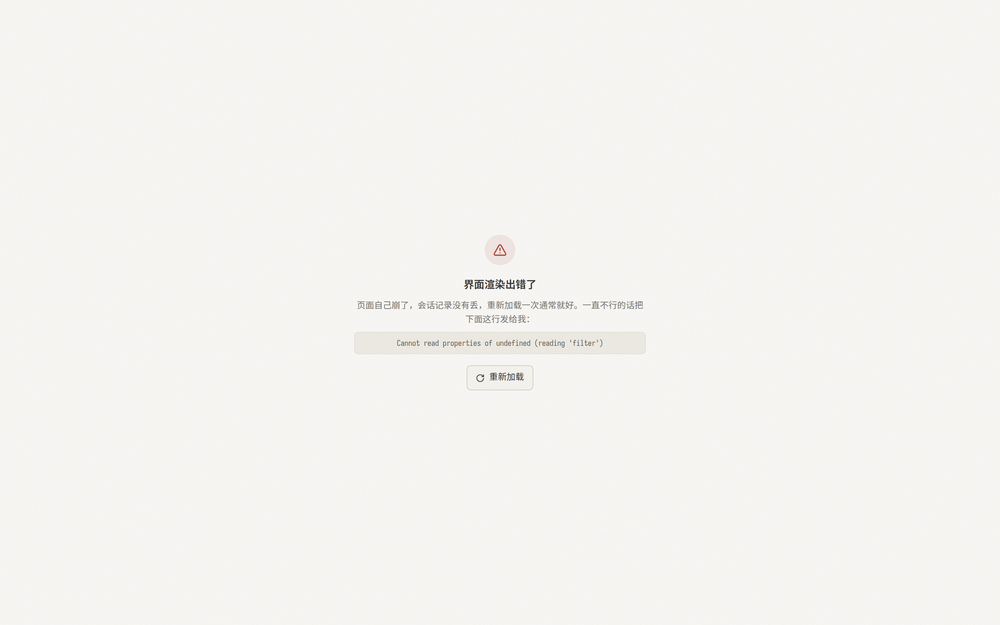
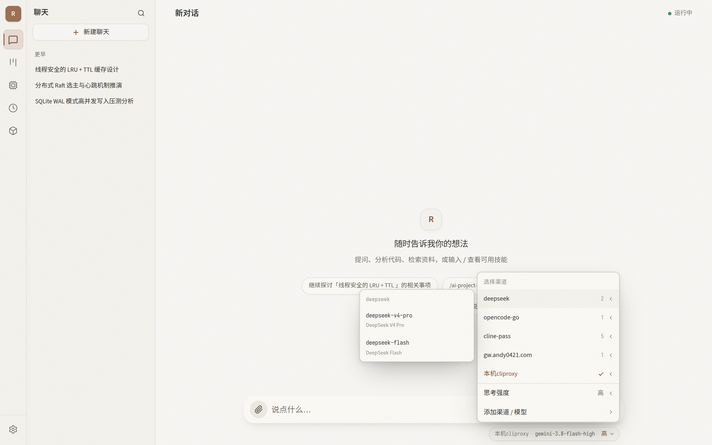
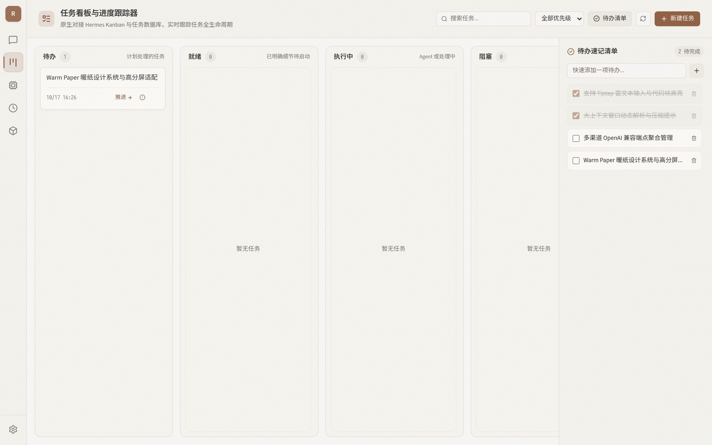
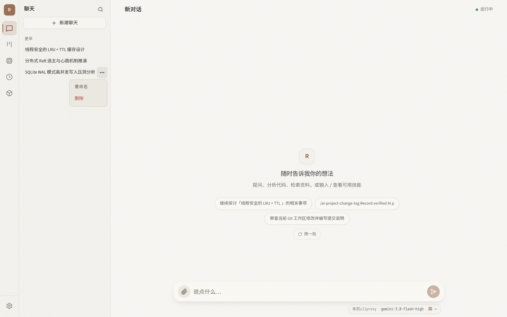

<div align="center">

# Hermes Relay

**A lightweight, in-process thin web shell for [Hermes Agent](https://hermes-agent.nousresearch.com/docs)**

[](LICENSE)
[](https://nextjs.org/)
[](https://python.org/)
[](https://tailwindcss.com/)
[](design-system/hermes-relay/MASTER.md)

[中文说明文档](README.md) · [UI Specification](PRODUCT.md) · [Design System](design-system/hermes-relay/MASTER.md)

<br />



</div>

<br />

## 📖 Core Philosophy

Hermes Relay does not re-invent the agent, nor does it maintain a duplicate data store: model calls, tool executions, approval gates, skills, persistent memories, session databases, and context compaction are **all directly powered by Hermes itself**.

This project focuses on three missions:
1. **In-process Native Connectivity**: The Python backend runs straight inside Hermes' virtual environment, constructing `AIAgent` instances within the exact same process. Tool execution callbacks, approval blocking, and clarify questions respond with zero network transit overhead.
2. **Zero Third-Party Python Dependencies**: The backend relies purely on the Python standard library (`ThreadingHTTPServer` + SSE streaming pipeline), keeping the agent environment clean and resilient to upstream upgrades.
3. **Immersive Warm Paper Design**: Built on Next.js 16 + Tailwind v4 with the custom "Warm Paper" aesthetic, calibrated for high-density technical reading, typography harmony, syntax highlighting, and an integrated workbench.

---

## ✨ Features

### 💬 Conversational Intelligence & Streaming Inference
- **Reasoning & Tool Call Collapsibles**: Distinct streaming for assistant text and reasoning thoughts (Chain of Thought), complete with expandable parameters and stdout blocks.
- **In-Process Approval Gate**: Prompt interactive authorization cards whenever the agent requests shell execution or file modifications (`Once` / `Session` / `Always` / `Deny`).
- **Clarification Questions**: Step-by-step interactive forms with multi-select and text input support.
- **Mid-Turn Steer & Interrupt**: Steer agent actions during generation or cleanly interrupt live streaming.
- **Performance Metrics**: Real-time TTFT (Time To First Token), true token generation rates (Tok/s), and duration tracking.
- **Authoritative Context Gauge**: Ring meters and compaction thresholds queried straight from Hermes' core engine with accurate prefix cache hit ratios.

<br />

### 🎛️ Multi-Channel & Model Management
<div align="center">
  
</div>

- **Aggregate Any OpenAI-Compatible Endpoints**: Connect with Base URL + API Key to automatically discover all available models.
- **5-Level Reasoning Effort Toggle**: Instantly switch reasoning intensity (Off, Low, Medium, High, Max) across turns with zero service restarts.
- **Configuration Isolation**: Custom channels and models are kept inside `~/.hermes/hermes-relay/models.json`, **never touching Hermes' global `config.yaml`**, keeping CLI, WeChat, and Telegram channels unaffected.

<br />

### 🛠️ Integrated Workbench
<div align="center">
  
</div>

- **Task Board (Kanban)**: Local SQLite-backed board with full CRUD and drag-and-drop state transitions.
- **Scheduled Jobs (Cron)**: Direct visibility and control over Hermes' cron jobs (`~/.hermes/cron/jobs.json`) with immediate manual triggering.
- **Process Telemetry**: Real-time inspection of host processes, memory footprints, and daemon statuses.
- **Artifact Sandbox**: Direct file tree access to agent workspace outputs.

<br />

### ⚙️ Settings & Persistent Memory Management
<div align="center">
  
</div>

- **Custom Model Edit Modal**: Dedicated controls to update display names, upstream model IDs, and override context windows.
- **Memory Triad Editing**: Inspect and edit `memory`, `user`, and `soul` files with automatic rolling backups (retaining the 20 most recent snapshots).
- **Self-Hosted Typography**: Fully self-hosted Source Sans 3, Noto Sans SC, and Sarasa Mono SC font subsets for pixel-perfect code alignment.

---

## 🏗️ Architecture

```
Browser (Next.js 16 WebUI)
   │
   ├── [HTTP / SSE Stream] ──▶ server.py (8788, Standard Library Only)
   │                               │
   │                               ├──▶ agent_bridge.py
   │                               │       │
   │                               │       └──▶ AIAgent (In-process Hermes Runtime)
   │                               │
   │                               ├──▶ sessions.py ──▶ ~/.hermes/state.db
   │                               ├──▶ models.py   ──▶ ~/.hermes/hermes-relay/models.json
   │                               └──▶ workbench_api.py ──▶ kanban.db / cron / processes
   │
   └── [Static Assets / WebUI] ──▶ Next.js Standalone (3220)
```

Nginx routes traffic as the primary reverse proxy:
- `/api/` directly hits the Python backend (`8788`), with `proxy_buffering off` to ensure low-latency SSE delivery.
- `/`, `/_next/static/`, and static assets route to the Next.js Standalone service (`3220`).

---

## 🚀 Quick Start

### Prerequisites
- A working installation of [Hermes Agent](https://hermes-agent.nousresearch.com/docs)
- Node.js 20.9+
- Nginx (recommended for production reverse proxy)
- `p7zip-full` (`sudo apt install p7zip-full` for font extraction)

### 1. Clone the Repository
```bash
git clone https://github.com/wanglixu/hermes-relay.git /opt/hermes-relay
cd /opt/hermes-relay
```

### 2. Fetch Self-Hosted Fonts
```bash
bash web/scripts/fetch-fonts.sh
```

### 3. Build Web Frontend
```bash
cd web
npm ci
npm run build

# Standalone build requires copying static assets
cp -r .next/static .next/standalone/.next/
cp -r public .next/standalone/
cd ..
```

### 4. Start Backend Server
> **Note**: You must run the backend with Hermes Agent's Python venv to import agent runtime packages in-process.

```bash
/usr/local/lib/hermes-agent/venv/bin/python server.py
# In another terminal:
curl -s http://127.0.0.1:8788/api/health
# Expected output: {"ok": true}
```

### 5. Install Systemd Services
```bash
sudo cp deploy/hermes-relay.service /etc/systemd/system/
sudo cp deploy/hermes-relay-web.service /etc/systemd/system/
sudo systemctl daemon-reload
sudo systemctl enable --now hermes-relay hermes-relay-web
```

### 6. Configure Nginx
Copy `deploy/nginx-relay.conf` to `/etc/nginx/sites-available/`, configure your domain and SSL certificates, then reload:
```bash
sudo nginx -t && sudo systemctl reload nginx
```

---

## 📡 API Contract

| Method | Endpoint | Description |
| :--- | :--- | :--- |
| `GET` | `/api/health` | Health check probe |
| `GET` | `/api/config` | Read active model & channel config |
| `GET` | `/api/models` | List available models, channels, active selection, and effort presets |
| `POST` | `/api/models/select` | Switch active model or effort (`{key?, effort?}`) |
| `POST` | `/api/models/test` | Test endpoint connectivity and enumerate supported models |
| `POST` | `/api/models/add` | Add a standalone custom model |
| `POST` | `/api/models/update` | Update custom model display name, model ID, or context window |
| `POST` | `/api/models/remove` | Delete a custom model |
| `POST` | `/api/channels/add` | Add an OpenAI-compatible channel |
| `POST` | `/api/channels/sync` | Re-sync model listing from channel |
| `POST` | `/api/channels/remove` | Delete a channel |
| `GET` | `/api/chats?limit=&offset=&q=` | Query sessions with pagination and search |
| `POST` | `/api/chats` | Allocate session ID (**lazy creation**: persisted upon first turn) |
| `GET` | `/api/chats/<id>?turns=&before=` | Session transcript windowing |
| `GET` | `/api/chats/<id>/stream?after=N` | SSE reconnect & replay stream |
| `GET` | `/api/chats/<id>/context` | Authoritative context window usage & cache hit stats |
| `POST` | `/api/chats/<id>/turn` | **Send turn message** (SSE streaming events) |
| `POST` | `/api/chats/<id>/interrupt` | Immediately abort active turn |
| `POST` | `/api/chats/<id>/steer` | Inject prompt mid-generation |
| `POST` | `/api/chats/<id>/compress` | Trigger manual context compaction with focus hint |
| `PATCH` | `/api/chats/<id>` | Rename session title |
| `DELETE` | `/api/chats/<id>` | Physical deletion of session |
| `POST` | `/api/approvals` | Approval response (`once` / `session` / `always` / `deny`) |
| `POST` | `/api/clarify` | Respond to clarifying question |
| `POST` | `/api/upload?session=&name=` | Upload attachment for native multimodal vision |
| `GET` | `/api/kanban/tasks?status=` | Task board CRUD |
| `GET` | `/api/cron/jobs` | Cron job listing & toggle execution |
| `GET` | `/api/system/processes` | System process monitor |
| `POST` | `/api/admin/restart` | **Graceful Restart**: safely queued until the active turn ends |

---

## 📄 License

This project is open-source software licensed under the [MIT License](LICENSE).
